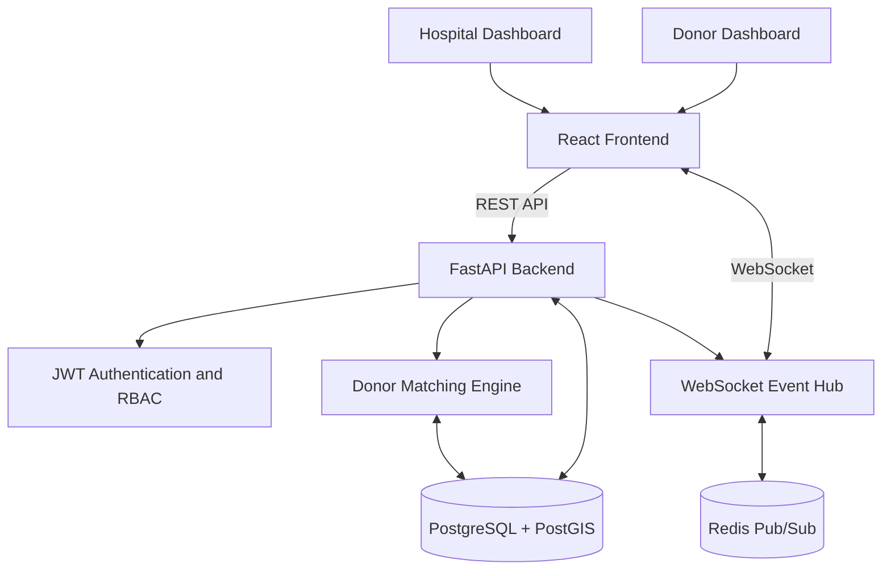

# 🩸 Blood Donor–Hospital Matching Platform

**A real-time blood donor matching system that helps hospitals identify, contact, and coordinate with eligible donors.**

The platform combines geospatial filtering, explainable donor ranking, role-based access control, real-time WebSocket communication, and a React-based dashboard to streamline the hospital-to-donor workflow.

**Built with:** FastAPI · PostgreSQL · PostGIS · React · TypeScript · WebSockets · Redis · Leaflet

---

## 📌 Table of Contents

- [Overview](#-overview)
- [Key Features](#-key-features)
- [System Architecture](#-system-architecture)
- [Technology Stack](#-technology-stack)
- [How Donor Matching Works](#-how-donor-matching-works)
- [Privacy and Security](#-privacy-and-security)
- [Getting Started](#-getting-started)
- [Demo Accounts](#-demo-accounts)
- [API Workflow](#-api-workflow)
- [Real-Time Communication](#-real-time-communication)
- [Testing](#-testing)
- [Current Scope and Limitations](#-current-scope-and-limitations)
- [Future Enhancements](#-future-enhancements)

---

## 🎯 Overview

Finding suitable blood donors during urgent situations involves more than identifying people with a compatible blood group. Availability, travel distance, donation history, reliability, and response time can all affect the matching process.

The Blood Donor–Hospital Matching Platform addresses this coordination problem through a centralized application where hospitals can create blood requests, discover ranked eligible donors, send invitations, and track donor responses in real time.

### How it works

1. A verified hospital creates a blood request with the required blood group, units, urgency, deadline, and maximum distance.
2. The matching engine filters eligible donors using blood group, availability, donation interval, verification status, and geospatial distance.
3. Eligible donors are ranked using a weighted scoring system, with explanations for their scores.
4. The hospital sends requests to selected donors.
5. Donors accept or decline through their dashboard.
6. The hospital receives live status updates and can record completed donations.

The system is designed to prioritize eligibility and privacy before ranking convenience or responsiveness.

---

## ✨ Key Features

### 🏥 Hospital Dashboard

- Create and manage blood requests.
- Discover the top three eligible donors.
- View donor rankings, scores, and explanations.
- Send donor invitations and track responses.
- View donor contact details only after acceptance.
- Record completed donations and cancel requests.
- Visualize the hospital's location and donor-distance ranges on an interactive map.

### 🩸 Donor Dashboard

- Manage donor availability.
- View incoming blood donation requests.
- Accept or decline invitations.
- Receive real-time updates without manually refreshing the dashboard.

### 📍 Geospatial Donor Matching

- PostgreSQL with PostGIS for location-aware filtering.
- Distance-based eligibility using spatial queries.
- Donor-specific travel preferences and weekend travel radius.
- Interactive Leaflet map with distance circles instead of exposing donor coordinates.

### ⚡ Real-Time Communication

- WebSocket-based updates for hospitals and donors.
- Automatic reconnection in the frontend.
- Redis Pub/Sub support for distributing events across multiple application workers.
- REST API re-fetching to synchronize the interface with the database.

### 🔐 Authentication and Access Control

- JWT-based authentication.
- Role-based access for donors, hospitals, and administrators.
- Bcrypt password hashing.
- Verification requirements for hospitals and donors.
- Restricted access to donor contact information.

### 🧪 Testing and Development

- Automated backend unit tests.
- Synthetic donor data generation for testing at scale.
- Swagger UI for API exploration.
- Docker Compose for running the backend and database together.

---

## 🏗️ System Architecture



### Architecture overview

| Component           | Responsibility                                                               |
| ------------------- | ---------------------------------------------------------------------------- |
| React frontend      | Hospital and donor dashboards, routing, map visualization, and data fetching |
| FastAPI backend     | REST endpoints, authentication, request processing, and business logic       |
| PostgreSQL          | Persistent storage for users, hospitals, donors, requests, and matches       |
| PostGIS             | Geospatial filtering and distance calculations                               |
| WebSocket event hub | Pushes donor responses and request status changes to connected users         |
| Redis Pub/Sub       | Cross-worker event delivery when multiple workers or containers are used     |

The database remains the source of truth. Real-time events improve responsiveness, while REST requests keep the interface synchronized with persisted data.

---

## 🛠️ Technology Stack

| Layer                            | Technologies               |
| -------------------------------- | -------------------------- |
| Frontend                         | React 18, TypeScript, Vite |
| UI and styling                   | Tailwind CSS               |
| Routing                          | React Router               |
| Server-state management          | TanStack React Query       |
| Maps                             | Leaflet                    |
| Backend                          | Python, FastAPI            |
| API communication                | REST, WebSockets           |
| Database                         | PostgreSQL                 |
| Geospatial processing            | PostGIS                    |
| Authentication                   | JWT, bcrypt                |
| Event distribution               | Redis Pub/Sub              |
| Deployment and local development | Docker, Docker Compose     |
| Testing                          | Python `unittest`          |

---

## 🧠 How Donor Matching Works

The matching engine uses a **two-stage approach: hard eligibility filtering followed by weighted ranking.**

### 1. Hard eligibility filters

A donor must satisfy the configured eligibility conditions before being considered for ranking.

- Exact blood-group match.
- Verified donor status.
- Availability status set to `AVAILABLE`.
- Minimum interval since the previous donation.
- Within the hospital request's maximum distance.
- Not already contacted for the same request.

Geospatial filtering uses PostGIS `ST_DWithin` with a GiST-indexed geography column.

**Important:** Ranking scores cannot override eligibility filters.

### 2. Travel policy

Travel eligibility depends on request urgency:

- **NORMAL:** Respects the donor's travel radius, including the configured weekend radius on Saturdays and Sundays.
- **URGENT:** Allows up to 1.5 times the donor's travel radius.
- **EMERGENCY:** Uses the hospital request's maximum distance as the travel limit.

### 3. Weighted donor ranking

Eligible candidates receive a score from 0 to 100.

| Ranking factor                             | Weight |
| ------------------------------------------ | -----: |
| Distance                                   |    30% |
| Availability and preferred hours           |    20% |
| Reliability: response and acceptance rates |    20% |
| Travel compatibility                       |    10% |
| ML acceptance probability                  |    10% |
| Donor rating                               |    10% |

The weights are configurable through environment settings. When the ML model is unavailable, its weight is redistributed to the other scoring factors.

Ties are broken deterministically using score, distance, and donor ID. Smoothed response and acceptance rates help avoid misleading results from very small sample sizes.

The engine scores up to 200 of the nearest eligible candidates by default; this limit can be configured.

---

## 🔐 Privacy and Security

Privacy is built into the donor-matching workflow.

- **Role-based access:** Separate `DONOR`, `HOSPITAL`, and `ADMIN` roles.
- **Authenticated endpoints:** JWT authentication and role checks.
- **Password protection:** Passwords are stored using bcrypt hashes.
- **Limited donor visibility:** Before acceptance, hospitals see an anonymized donor reference, blood group, distance, rating, response rate, and score.
- **Controlled disclosure:** Donor names and phone numbers are revealed to the hospital only after acceptance.
- **Request isolation:** Donors cannot see invitations that have not been sent to them.
- **Verification:** Only verified hospitals can create requests, and only verified donors can be matched.
- **Location privacy:** Donor coordinates are not sent to hospitals; the map displays distance rings instead of donor pins.

The project is intended as a development and demonstration system. Production deployment would require additional security hardening, operational monitoring, and review of applicable healthcare and privacy requirements.

---

## 🚀 Getting Started

### Prerequisites

- Git
- Docker and Docker Compose
- Node.js 18 or later for the React frontend

### 1. Clone the repository

```bash
git clone https://github.com/sahanar010/blood_donor.git
cd blood_donor
```

### 2. Configure environment variables

Review the environment configuration and example files in the repository. Configure the required database connection, secret key, and other settings for your local environment.

Do not commit real credentials, production secrets, or `.env` files containing sensitive information.

### 3. Start the backend and database

```bash
docker compose up --build
```

### 4. Generate synthetic donor data

In a second terminal, run:

```bash
docker compose exec backend python -m scripts.seed --donors 10000
```

This creates synthetic donor data for development and testing.

### 5. Explore the API

Open the following URLs after the backend starts:

- **Swagger UI:** http://localhost:8000/docs
- **Real-time demo:** http://localhost:8000/demo

Swagger UI allows you to explore endpoints, authenticate, and execute API requests.

### 6. Start the React frontend

Open another terminal:

```bash
cd frontend
```

Create your local environment file from the provided example:

```bash
cp .env.example .env
```

Ensure the frontend API URL points to the backend:

```env
VITE_API_URL=http://localhost:8000
```

Install dependencies and start the development server:

```bash
npm install
npm run dev
```

Open http://localhost:5173.

Keep the backend running and ensure the database has been seeded before testing the complete workflow.

> **Windows note:** If `cp` is unavailable in your terminal, use `Copy-Item .env.example .env` in PowerShell.

---

## 🔑 Demo Accounts

The repository provides synthetic accounts for local testing.

| Role     | Email                                                   | Password        |
| -------- | ------------------------------------------------------- | --------------- |
| Admin    | `admin@demo.local`                                      | `admin12345`    |
| Hospital | `hospital1@demo.local` through `hospital3@demo.local`   | `hospital12345` |
| Donor    | `donor00001@demo.local` and other seeded donor accounts | `donor12345`    |

These credentials are for the local demo only. Never reuse them in a deployed environment.

For donor accounts, the exact email-to-ID mapping depends on the generated seed data.

---

## 🔄 API Workflow

The following sequence demonstrates the core hospital-to-donor workflow.

| Step | Endpoint                                            | Purpose                                         |
| ---- | --------------------------------------------------- | ----------------------------------------------- |
| 1    | `POST /auth/login`                                  | Authenticate the hospital                       |
| 2    | `POST /hospital/requests`                           | Create a blood request                          |
| 3    | `POST /hospital/requests/{id}/find-donors`          | Find and rank eligible donors                   |
| 4    | `POST /hospital/requests/{id}/send-requests`        | Send invitations to selected donors             |
| 5    | `GET /donor/requests`                               | Retrieve invitations sent to a donor            |
| 6    | `POST /donor/requests/{match_id}/respond`           | Accept or decline an invitation                 |
| 7    | `GET /hospital/requests/{id}/matches`               | Check match statuses and accepted donor details |
| 8    | `POST /hospital/matches/{match_id}/record-donation` | Record a completed donation                     |

### Example blood request

```json
{
  "blood_group": "O+",
  "units_required": 1,
  "urgency": "EMERGENCY",
  "required_time": "2027-01-15T10:00:00",
  "max_distance_km": 15
}
```

Use a future `required_time` when testing. Naive timestamps are interpreted as Asia/Kolkata.

### Expected workflow

- The hospital receives ranked candidates with scores and explanations.
- Invitations transition to a requested state.
- The donor's response is reflected in the hospital dashboard.
- Contact details become visible after acceptance.
- Recording a donation updates donor history and can fulfil the request when all required units are recorded.
- If a donor declines, the hospital can run matching again; previously contacted donors are skipped.

---

## ⚡ Real-Time Communication

The application uses WebSockets to update connected dashboards when important events occur.

| Event             | Recipient                       | Trigger                                        |
| ----------------- | ------------------------------- | ---------------------------------------------- |
| `request.new`     | Donor                           | Hospital sends an invitation                   |
| `match.responded` | Hospital                        | Donor accepts or declines                      |
| `request.updated` | Hospital                        | Donation is recorded or request status changes |
| `request.closed`  | Donors with pending invitations | Request is fulfilled or cancelled              |

### Event flow

1. A REST endpoint processes an action and commits the database change.
2. The notification layer publishes the relevant event.
3. The event hub delivers it to connected users.
4. The frontend receives the event and re-fetches data through React Query.
5. The dashboard reflects the updated database state.

### Connection and scaling

- WebSocket connections authenticate using JWTs.
- Heartbeats run approximately every 30 seconds; idle connections are closed after 90 seconds.
- The frontend reconnects automatically and re-fetches data.
- Without Redis, the event hub uses in-memory connections and is suitable for a single-worker setup.
- Redis Pub/Sub supports event delivery across workers or API containers.

**Current limitation:** Offline donors do not receive mobile or web push notifications. They see pending invitations when they return to the application. A failed real-time push does not replace the need to retrieve current state from the API.

---

## 🧪 Testing

### Run backend unit tests

From the repository root:

```bash
cd backend
python3 -m unittest discover -s tests -v
```

The backend includes unit tests designed to exercise core functionality without requiring a live database, Redis, or FastAPI installation for those tests.

### Run the frontend build

```bash
cd frontend
npm install
npm run build
```

The frontend build also performs TypeScript checks.

### Test the matching engine independently

```bash
cd backend
python3 -m scripts.demo_rank
```

This provides a way to explore the ranking engine without running the full application stack.

---

## 📌 Current Scope and Limitations

The current repository implements the backend, real-time communication, and React frontend.

- The database tables are created at startup for development convenience. Production use should include Alembic migrations.
- The donation interval is configurable; the default 90-day value is a placeholder and must be reviewed against applicable blood-bank policy.
- Blood-group matching is exact. Clinical compatibility decisions are outside the ranking engine.
- The application uses synthetic data for demonstration and testing.
- Real-world donor acceptance rates and ranking effectiveness have not been established through clinical deployment.
- Registration and admin verification screens are not included in the initial React frontend; the corresponding API endpoints can be explored through Swagger UI.
- Request history, advanced filters, full donor profile editing, and frontend tests remain potential extensions.
- The `/demo` page is a development tool and should be disabled in production.

---

## 🔮 Future Enhancements

Potential extensions include:

- **Machine learning:** Predict donor acceptance probability using real, appropriately collected historical data.
- **Push notifications:** Add mobile notifications, email, or SMS for offline donors.
- **Production migrations:** Introduce Alembic migrations and structured database change management.
- **Frontend testing:** Add component, integration, and end-to-end tests.
- **Operational monitoring:** Add structured logging, metrics, health checks, and alerting.
- **Deployment:** Package and deploy the application using a production-ready cloud infrastructure.

These are proposed enhancements, not claims about currently implemented functionality.

---

## 👩‍💻 Project Information

**Project:** Blood Donor–Hospital Matching Platform  
**Focus areas:** Backend engineering, geospatial databases, real-time systems, authentication, and full-stack development.

Built to explore how software engineering can improve coordination between hospitals and potential blood donors.

If you find the project interesting, feel free to explore the source code and suggest improvements.

---

_Disclaimer: This project is an educational software prototype. It is not a substitute for clinical screening, professional blood-bank procedures, or medical advice._
